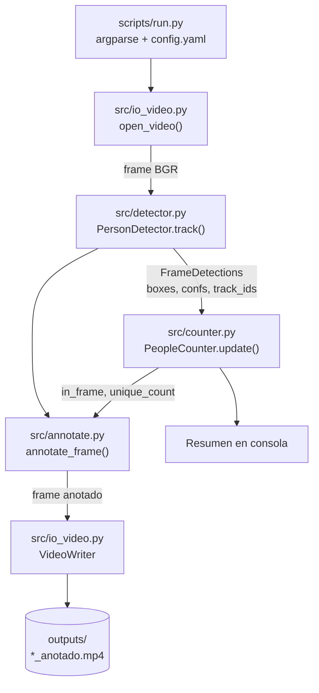

# 🏗️ Arquitectura — Lector de Personas

> **Documento vivo.** Explica cómo está construida la solución y por qué.
> Se actualiza con cada cambio relevante: módulos nuevos, decisiones de diseño y resultados de pruebas.
> Última actualización: **2026-10-29 · Fase 1**

---

## 1. 🎯 El problema y la solución

**Problema:** un negocio quiere saber cuánta gente hay, cuánta pasó y cuánta entró o salió, usando solo un video de cámara.

**Solución:** una canalización (pipeline) en tres capas:

| Capa | Qué resuelve | Tecnología |
|:--|:--|:--|
| **Detección** | ¿Dónde hay personas en este frame? | YOLO (clase COCO `0 = person`) |
| **Tracking** | ¿Es la misma persona del frame anterior? | ByteTrack → `track_id` |
| **Conteo** | ¿Cuántas hay / pasaron / entraron? | Lógica propia en `src/counter.py` |

Sin tracking no se puede contar personas únicas ni entradas/salidas sin contar doble. Por eso el conteo se apoya siempre en los IDs del tracker.

---

## 2. 🔄 Flujo de datos



Por cada frame:

1. `cap.read()` lee el frame (se salta según `vid_stride`).
2. `PersonDetector.track(frame)` corre YOLO + tracker con `persist=True`, así el tracker recuerda los IDs entre llamadas.
3. `PeopleCounter.update(n_boxes, track_ids)` actualiza los conteos.
4. `annotate_frame(...)` dibuja cajas, IDs y el panel.
5. Se escribe el frame en el video de salida y, cada `log_every` frames, se imprime el progreso con FPS.

---

## 3. 📁 Mapa de archivos

```
lector personas/
├── 📄 README.md            portada del proyecto
├── 🏗️ ARQUITECTURA.md      este documento
├── 🤖 CLAUDE.md            especificación y reglas de desarrollo
├── ⚙️ config.yaml          parámetros por defecto
├── 📦 requirements.txt
├── 🎥 videos/              entrada (fuera de git)
├── 📼 outputs/             salidas (fuera de git)
├── 🧠 models/              pesos .pt (fuera de git)
├── src/
│   ├── detector.py         modelo YOLO + tracking
│   ├── counter.py          lógica de conteo
│   ├── annotate.py         dibujo sobre el frame
│   └── io_video.py         lectura/escritura de video
├── scripts/
│   └── run.py              punto de entrada CLI
└── tests/
    ├── conftest.py         agrega la raíz al sys.path
    └── test_counter.py     pruebas del contador
```

| Archivo | Responsabilidad | Piezas principales | Estado |
|:--|:--|:--|:--:|
| `scripts/run.py` | Orquestar el pipeline y la CLI | `parse_args`, `merge_settings`, `run`, `log_progress` | ✅ |
| `src/io_video.py` | Abrir fuentes y escribir MP4 | `VideoInfo`, `open_video`, `create_writer`, `output_stem` | ✅ |
| `src/detector.py` | Envolver Ultralytics | `PersonDetector`, `FrameDetections` | ✅ |
| `src/counter.py` | Contar personas | `PeopleCounter` | ✅ |
| `src/annotate.py` | Dibujar resultados | `draw_detections`, `draw_panel`, `annotate_frame` | ✅ |
| `src/export.py` | CSV por segundo + JSON resumen | — | 🔜 Fase 2 |
| `src/pick_line.py` | Elegir la línea con clics | — | 🔜 Fase 2 |
| `tests/test_smoke.py` | Pipeline completo sobre un clip corto | — | 🔜 Fase 2 |

---

## 4. 🧩 Módulos en detalle

### `src/io_video.py`
- `open_video(source, default_fps)` acepta archivo, URL o índice de cámara (`"0"`). Si no abre, lanza `RuntimeError` y `run.py` termina con un mensaje claro.
- Si el video reporta **FPS = 0** (o un valor absurdo), usa `default_fps` (30).
- `create_writer` usa el códec `mp4v`. Si el video no abre en algún reproductor, reconvertir con `ffmpeg -vcodec libx264`.
- El FPS de salida es `fps / vid_stride`, para que la duración del video anotado sea la misma que la del original.

### `src/detector.py`
- `PersonDetector` carga el modelo una vez y llama a `model.track(frame, persist=True, classes=[0], ...)` frame a frame.
- Devuelve un `FrameDetections` con arreglos NumPy (ya en CPU), así el resto del código no depende de tensores de PyTorch.
- **`boxes.id` puede ser `None`** cuando el tracker aún no confirma tracks: en ese caso los IDs se marcan `None` y se dibujan como `persona`.

### `src/counter.py` — `PeopleCounter`
| Métrica | Cálculo |
|:--|:--|
| `in_frame` | número de cajas del frame actual |
| `max_simultaneous` | máximo histórico de `in_frame` |
| `unique_count` | IDs con al menos `min_track_frames` frames de vida |

El filtro `min_track_frames` (3 por defecto) evita contar como persona un ID que el tracker crea y descarta enseguida.

### `src/annotate.py`
- El tamaño del texto y el grosor escalan con la altura del frame (base 720p), para que se lea igual en 720p que en 4K.
- El panel dice `UNICOS` sin tilde porque `cv2.putText` no dibuja tildes (se corregirá en la Fase 4 con `supervision`/PIL).

### `scripts/run.py`
- Prioridad de configuración: **CLI > `config.yaml` > valores por defecto del código**.
- Inserta la raíz del repo en `sys.path` para poder importar `src.*` sin instalar el paquete.
- Con `q` (en `--show`) o `Ctrl+C`, guarda lo que ya procesó antes de salir.

---

## 5. 🧠 Decisiones de diseño

| Decisión | Alternativa descartada | Motivo |
|:--|:--|:--|
| Leer frames con OpenCV y llamar a `model.track(frame)` uno por uno | `model.track(source=..., stream=True)` | Control total del frame (stride, escritura, ventana) y de los metadatos del video |
| Lógica de conteo propia | `solutions.ObjectCounter` | Permite conteo de únicos con filtro, pruebas unitarias sin video y CSV por segundo |
| `FrameDetections` en NumPy | Pasar `Results` de Ultralytics | Desacopla el conteo y la anotación de Ultralytics; facilita las pruebas |
| PyTorch con CUDA 12.6 | Solo CPU | El equipo de desarrollo tiene una RTX 3050 6 GB (`--device 0`) |

---

## 6. 🧪 Pruebas y resultados

### Pruebas unitarias (`pytest -q`)
| Prueba | Verifica |
|:--|:--|
| `test_in_frame_and_max_simultaneous` | conteo por frame y máximo simultáneo |
| `test_unique_requires_min_track_frames` | un ID solo cuenta tras N frames |
| `test_none_ids_are_ignored` | `boxes.id = None` no rompe ni suma únicos |
| `test_same_id_counted_once` | un ID se cuenta una sola vez |

### Corridas sobre video real
| Fecha | Video | Modelo / parámetros | Únicos | Máx. simultáneo | Esperado (manual) | FPS | Notas |
|:--|:--|:--|:--:|:--:|:--:|:--:|:--|
| 2026-10-29 | `hombre_entrando_tienda.mp4` (Pexels 6685167, 4K, 16 s, 478 frames) | `yolo26n`, conf 0.35, imgsz 640, ByteTrack, GPU RTX 3050 | **2** | **2** | 2 (cliente + vendedora) | 7.8 | ✅ Sin error. IDs estables todo el clip. El cuello de botella es leer/escribir 4K, no la GPU |
<!-- RESULTADOS -->

> 📌 **Entorno de la corrida:** Python 3.13, torch 2.14.1+cu126, ultralytics 8.4.192, opencv 5.0.0.
> 💡 **Pendiente:** redimensionar internamente los videos 4K a 1080p para subir los FPS (ver §12 de `CLAUDE.md`).

---

## 7. 📜 Historial de cambios

| Fecha | Fase | Cambio |
|:--|:--|:--|
| 2026-10-29 | 1 | Estructura inicial, `run.py`, detector, contador, anotación, pruebas del contador |
| 2026-10-29 | 1 | README rediseñado, este documento, entorno `.venv` con CUDA y primera corrida real |
