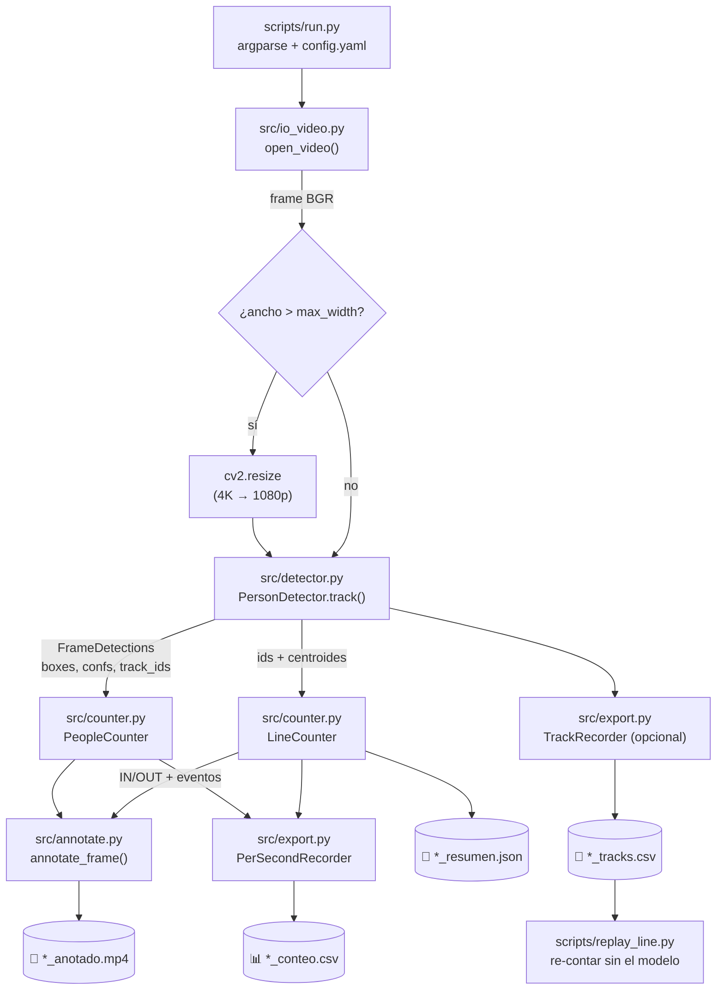

# 🏗️ Arquitectura — Lector de Personas

> **Documento vivo.** Explica cómo está construida la solución y por qué.
> Se actualiza con cada cambio relevante: módulos nuevos, decisiones de diseño y resultados de pruebas.
> Última actualización: **2026-10-29 · Fase 2**

---

## 1. 🎯 El problema y la solución

**Problema:** un negocio quiere saber cuánta gente hay, cuánta pasó y cuánta entró o salió, usando solo un video de cámara.

**Solución:** una canalización (pipeline) en tres capas:

| Capa | Qué resuelve | Tecnología |
|:--|:--|:--|
| **Detección** | ¿Dónde hay personas en este frame? | YOLO (clase COCO `0 = person`) |
| **Tracking** | ¿Es la misma persona del frame anterior? | ByteTrack / BoT-SORT → `track_id` |
| **Conteo** | ¿Cuántas hay / pasaron / entraron / salieron? | Lógica propia en `src/counter.py` |

Sin tracking no se puede contar personas únicas ni entradas/salidas sin contar doble. Por eso el conteo se apoya siempre en los IDs del tracker.

| Métrica | Confiabilidad | Comentario |
|:--|:--:|:--|
| En pantalla (por frame) | 🟢 alta | Solo depende del detector |
| Entradas / salidas (línea) | 🟢 buena | 11 % de error en el video del restaurante (§6) |
| Únicos | 🔴 baja con oclusiones | Cada corte de track crea un ID nuevo: 112 "únicos" en un video con ~25 personas |

---

## 2. 🔄 Flujo de datos



Por cada frame:

1. `cap.read()` lee el frame (se salta según `vid_stride`) y, si es más ancho que `max_width`, se reduce.
2. `PersonDetector.track(frame)` corre YOLO + tracker con `persist=True`, así el tracker recuerda los IDs entre llamadas.
3. `PeopleCounter.update(...)` actualiza en pantalla / únicos / máximo simultáneo.
4. `LineCounter.update(ids, centroides, frame)` detecta cruces y devuelve los eventos nuevos (se imprimen en consola).
5. `PerSecondRecorder` acumula una fila por segundo; `TrackRecorder` (con `--save-tracks`) guarda cada detección.
6. `annotate_frame(...)` dibuja línea, banda, cajas, IDs, centroides y panel; la línea parpadea en verde tras un cruce.
7. Al terminar se escriben el CSV, el JSON (con modelo, versiones, parámetros y eventos) y, si se pidió, los tracks.

---

## 3. 📁 Mapa de archivos

```
lector personas/
├── 📄 README.md                 portada del proyecto
├── 🏗️ ARQUITECTURA.md           este documento
├── 🤖 CLAUDE.md                 especificación y reglas de desarrollo
├── ⚙️ config.yaml               parámetros por defecto
├── 📦 requirements.txt
├── 🎥 videos/                   entrada (fuera de git)
├── 📼 outputs/                  salidas (fuera de git)
├── 🧠 models/                   reservado para pesos (fuera de git)
├── src/
│   ├── detector.py              modelo YOLO + tracking
│   ├── counter.py               PeopleCounter + LineCounter
│   ├── annotate.py              dibujo sobre el frame
│   ├── io_video.py              lectura/escritura/redimensionado de video
│   ├── export.py                CSV por segundo, JSON, tracks
│   └── pick_line.py             elegir la línea con clics
├── scripts/
│   ├── run.py                   punto de entrada CLI
│   ├── replay_line.py           re-contar cruces desde tracks guardados
│   └── download_test_videos.md  registro de videos, licencias y conteos manuales
└── tests/
    ├── conftest.py              agrega la raíz al sys.path
    ├── test_counter.py          PeopleCounter + LineCounter (trayectorias sintéticas)
    ├── test_export.py           CSV por segundo, JSON y tracks
    ├── test_pick_line.py        escalado de coordenadas de pantalla → originales
    └── test_smoke.py            pipeline completo sobre 45 frames reales
```

| Archivo | Responsabilidad | Piezas principales | Estado |
|:--|:--|:--|:--:|
| `scripts/run.py` | Orquestar el pipeline y la CLI | `parse_args`, `merge_settings`, `run`, `build_summary` | ✅ |
| `scripts/replay_line.py` | Ajustar línea/banda en segundos | `replay`, barrido de `--line` y `--band` | ✅ F2 |
| `src/io_video.py` | Abrir fuentes, redimensionar, escribir MP4 | `open_video`, `resize_scale`, `scaled_size`, `create_writer` | ✅ |
| `src/detector.py` | Envolver Ultralytics | `PersonDetector`, `FrameDetections` | ✅ |
| `src/counter.py` | Contar personas | `PeopleCounter`, `LineCounter`, `CrossingEvent`, `parse_line` | ✅ F2 |
| `src/annotate.py` | Dibujar resultados | `draw_line`, `draw_band`, `draw_panel`, `annotate_frame` | ✅ F2 |
| `src/export.py` | Persistir resultados | `PerSecondRecorder`, `TrackRecorder`, `write_csv`, `write_json` | ✅ F2 |
| `src/pick_line.py` | Elegir la línea con clics | `pick`, `display_scale`, `to_original` | ✅ F2 |
| `tests/` | 29 pruebas | ver §6 | ✅ |

---

## 4. 🧩 Módulos en detalle

### `src/io_video.py`
- `open_video(source, default_fps)` acepta archivo, URL o índice de cámara (`"0"`). Si no abre, lanza `RuntimeError`.
- Si el video reporta **FPS = 0** (o un valor absurdo), usa `default_fps` (30).
- `resize_scale` / `scaled_size`: factor para no superar `max_width` (por defecto 1920) con ancho/alto pares.
- `create_writer(path, size, fps)` usa `mp4v`. El FPS de salida es `fps / vid_stride` para conservar la duración.

### `src/detector.py`
- `PersonDetector` carga el modelo una vez y llama a `model.track(frame, persist=True, classes=[0], ...)` frame a frame.
- Devuelve `FrameDetections` con arreglos NumPy (en CPU): el resto del código no depende de tensores de PyTorch.
- **`boxes.id` puede ser `None`** cuando el tracker aún no confirma tracks: los IDs se marcan `None`.
- Los pesos se descargan en la carpeta desde donde se ejecuta (raíz del repo); `*.pt` está en `.gitignore`.

### `src/counter.py`

**`PeopleCounter`**

| Métrica | Cálculo |
|:--|:--|
| `in_frame` | número de cajas del frame actual |
| `max_simultaneous` | máximo histórico de `in_frame` |
| `unique_count` | IDs con al menos `min_track_frames` frames de vida |

**`LineCounter`** — cruce de un segmento `p1 → p2`

```
lado = signo( (x2-x1)·(cy-y1) − (y2-y1)·(cx-x1) )      ← producto cruz, centroide (cx, cy)
  −  →  +   ⇒ IN      (con --invert: OUT)
  +  →  −   ⇒ OUT
```

| Regla | Para qué |
|:--|:--|
| Solo cuenta si la proyección del centroide cae **dentro del segmento** | No contar a quien pasa por la prolongación de la línea |
| Una vez **por dirección** por ID (por defecto) | No contar doble a la misma persona |
| `once_per_id`: una sola vez **en total** por ID (primer cruce) | Eliminar rebotes de quien sale y se queda parado en la puerta |
| `band` (±px): zona muerta; hay que salir por el otro lado | Absorber temblores pequeños del centroide |
| `min_track_frames` (3) | Ignorar IDs efímeros del tracker |
| Punto exactamente sobre la línea (lado 0) no cambia el estado | El cruce se registra cuando termina de pasar |

Cada cruce genera un `CrossingEvent(track_id, direction, frame_idx)` que va a consola y al JSON: así cada número es auditable.

### `src/annotate.py`
- Texto y grosor escalan con la altura del frame (base 720p).
- Panel: `EN PANTALLA`, `UNICOS` y, con línea, `ENTRADAS` (verde) y `SALIDAS` (rojo). Sin tildes porque `cv2.putText` no las dibuja.
- La línea es magenta, sus bordes de banda son líneas finas, y se pone **verde 0.4 s** tras cada cruce. Con línea se dibuja el centroide de cada persona (el punto que decide el cruce).

### `src/export.py`
- `PerSecondRecorder`: una fila por segundo → `segundo, en_pantalla, unicos_acumulados, entradas_acum, salidas_acum`. `en_pantalla` es el **máximo** de ese segundo.
- `TrackRecorder`: cada detección con ID en **píxeles originales** (`frame, track_id, cx, cy, x1, y1, x2, y2, conf`).
- `*_resumen.json`: fuente, fecha, video (resoluciones, FPS, duración), resultados, **lista de eventos**, parámetros, entorno (ultralytics, torch, GPU) y rendimiento. Es el respaldo de los números del anuncio (§9 de `CLAUDE.md`).

### `src/pick_line.py`
- Muestra un frame reducido para caber en 1280×720, recibe 2 clics y devuelve la línea en **píxeles originales** (`--line x1,y1,x2,y2`). `r` reinicia, Enter confirma, `q` sale.

### `scripts/replay_line.py`
- Lee `*_tracks.csv` y vuelve a correr `LineCounter` con otras líneas/bandas **sin el modelo** (milisegundos en vez de ~100 s).
- `--expected-in/--expected-out` imprime el error %; `--events` lista cada cruce con su segundo.

### `scripts/run.py`
- Prioridad de configuración: **CLI > `config.yaml` > `DEFAULTS`**.
- `--line` se da en píxeles **originales**; si el video se reduce, la línea y la banda se escalan solas.
- `--max-frames N` procesa solo los primeros N frames (pruebas). Con `q` o `Ctrl+C` guarda lo procesado.

---

## 5. 🧠 Decisiones de diseño

| Decisión | Alternativa descartada | Motivo |
|:--|:--|:--|
| Leer frames con OpenCV y llamar a `model.track(frame)` uno por uno | `model.track(source=..., stream=True)` | Control total del frame (stride, redimensionado, escritura, ventana) |
| Lógica de conteo propia | `solutions.ObjectCounter` | Únicos con filtro, eventos auditables, pruebas sin video, CSV por segundo |
| `FrameDetections` en NumPy | Pasar `Results` de Ultralytics | Desacopla conteo/anotación de Ultralytics; facilita pruebas |
| PyTorch con CUDA 12.6 | Solo CPU | El equipo tiene una RTX 3050 6 GB (`--device 0`) |
| `max_width: 1920` por defecto | Procesar 4K nativo | **7.8 → 17.9 FPS** con el mismo conteo (§6) |
| Línea en píxeles originales, escalada internamente | Pedirla en píxeles procesados | La línea no cambia si se cambia `max_width` |
| `once_per_id` como **opción** (no por defecto) | Cambiar el comportamiento base | `CLAUDE.md` define "una vez por dirección"; `once_per_id` ganó en el restaurante pero pierde a quien entra y sale con el mismo ID |
| `band` como opción, por defecto 0 | Banda fija | En el restaurante **empeoró** el conteo: los tracks se cortan en la puerta y la banda se come cruces reales (§6) |
| Guardar tracks + `replay_line.py` | Re-correr el modelo para cada prueba | Ajustar línea/banda en segundos en vez de minutos |

---

## 6. 🧪 Pruebas y resultados

### Pruebas automáticas (`pytest -q` → 29 ✅)
| Archivo | Verifica |
|:--|:--|
| `test_counter.py` | por frame, únicos, `None` ids, lado de la línea, IN/OUT, `invert`, prolongación, una vez por dirección, tracks jóvenes, punto sobre la línea, varios tracks, banda (temblor, cruce completo, regreso), `once_per_id`, distancia con signo, errores |
| `test_export.py` | filas por segundo (máximo + acumulados), escritura CSV/JSON, tracks en píxeles originales |
| `test_pick_line.py` | escala de pantalla, conversión a píxeles originales, formato `--line` |
| `test_smoke.py` | pipeline real (45 frames, 960 px): genera video, CSV y JSON consistentes |

### Corridas sobre video real
| Fecha | Video | Modelo / parámetros | Únicos | Máx. sim. | IN / OUT | Esperado (manual) | FPS | Notas |
|:--|:--|:--|:--:|:--:|:--:|:--:|:--:|:--|
| 2026-10-29 | `hombre_entrando_tienda` (4K, 16 s) | `yolo26n`, 640, ByteTrack, 4K nativo | **2** | **2** | — | 2 únicos | 7.8 | ✅ IDs estables. Cuello de botella: leer/escribir 4K |
| 2026-10-29 | `hombre_entrando_tienda` | ídem + `max_width 1920` | **2** | **2** | — | 2 únicos | **17.9** | ✅ Mismo conteo, 2.3× más rápido |
| 2026-10-29 | `restaurante_entradas_salidas` (4K, 56 s) | `yolo26n`, 640, ByteTrack, línea x=1600 | 91 | 9 | 2 / 4 | 3 / 6 | 19.8 | ❌ ID 37 SALE y luego ENTRA (parado en la puerta) |
| 2026-10-29 | `restaurante_entradas_salidas` | `yolo26s`, 960, BoT-SORT, línea x=1600 | 112 | 12 | 3 / 5 | 3 / 6 | 16.1 | ⚠️ Total parecido pero con 2 eventos falsos (rebotes) |
| 2026-10-29 | `restaurante_entradas_salidas` | **`yolo26s`, 960, BoT-SORT, línea x=1500, `once_per_id`** | 112 | 12 | **3 / 5** | 3 / 6 | 16.1 | ✅ **8/8 eventos reales**, 1 salida perdida → **error 11 %** |
<!-- RESULTADOS -->

> 📌 **Entorno:** Python 3.13, torch 2.14.1+cu126, ultralytics 8.4.192, opencv 5.0.0, RTX 3050 6 GB.

#### Barrido en el restaurante (con `replay_line.py` + simulación de reglas)
IN/OUT obtenidos, esperado **3 / 6**:

| Línea x | Banda | n + ByteTrack, por dirección | s + BoT-SORT, por dirección | s + BoT-SORT, `once_per_id` |
|:--:|:--:|:--:|:--:|:--:|
| 1500 | 0 | 3 / 4 | 4 / 5 | **3 / 5** ⭐ |
| 1500 | 50 | 2 / 4 | 3 / 4 | 3 / 4 |
| 1600 | 0 | 2 / 4 | 3 / 5 | 2 / 4 |
| 1600 | 50 | 2 / 3 | 3 / 4 | 2 / 4 |
| 1700 | 0 | 2 / 5 | 5 / 5 | 3 / 5 |
| 1850 | 0 | 3 / 5 | 4 / 6 | 1 / 6 |
| 2000 | 0 | 0 / 4 | 0 / 4 | — |

**Lecciones:**
1. 🧱 El error dominante es la **fragmentación de tracks en la puerta de vidrio**: el ID se pierde detrás del vidrio y el nuevo nace ya del otro lado, así que no hay cruce. Un modelo más grande y BoT-SORT ayudan.
2. 🔁 El segundo error son los **rebotes** de quien se queda sobre la línea; `once_per_id` los elimina.
3. 📏 La **banda** no ayudó aquí: en personas muy cerca de la cámara el centroide se mueve más de 50 px y, con tracks cortos, la banda descarta cruces reales.
4. 🎯 Pequeños cambios de posición de la línea (±100 px) cambian mucho el resultado → **siempre validar la línea con `replay_line.py`** contra un conteo manual.
5. 🔢 "Únicos" no sirve en escenas con oclusión (112 vs ~25 personas reales): usar el conteo por línea, como advierte `CLAUDE.md`.

---

## 7. 📜 Historial de cambios

| Fecha | Fase | Cambio |
|:--|:--|:--|
| 2026-10-29 | 1 | Estructura inicial, `run.py`, detector, contador, anotación, pruebas del contador |
| 2026-10-29 | 1 | README rediseñado, este documento, entorno `.venv` con CUDA y primera corrida real |
| 2026-10-29 | 2 | `LineCounter` (IN/OUT, segmento, banda, `once_per_id`) con 18 pruebas; `export.py` (CSV por segundo, JSON con eventos y entorno, tracks); `pick_line.py`; `replay_line.py`; `--max-width` (4K→1080p); `test_smoke.py`; registro de videos con conteos manuales; evaluación en el restaurante: error 11 % |

## 8. 🔜 Siguientes pasos

- Bajar el error de salidas: probar `yolo26m`, `imgsz 1280` y ajustar `track_buffer` de BoT-SORT para que el ID sobreviva detrás del vidrio.
- Segundo video del Caso A (supermercado) y CAVIAR con *ground truth* oficial, para no ajustar todo a un solo clip.
- Fase 3: zonas múltiples (`RegionCounter`), `--blur-faces`, comparativas de FPS CPU vs GPU.
