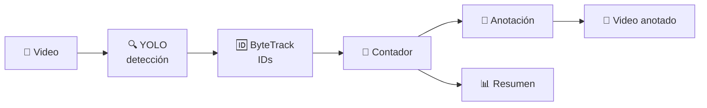

<div align="center">

# 👥 Lector de Personas

### Detecta, sigue y cuenta personas en video con inteligencia artificial

*Cuántas personas hay ahora mismo, cuántas pasaron en total y, pronto, cuántas **entraron** y **salieron** de tu negocio.*

<br>


</div>

---

## ✨ ¿Qué hace?

<table>
<tr>
<td width="25%" align="center">🎥<br><b>Recibe un video</b><br><sub>.mp4, .avi, .mov, URL o cámara</sub></td>
<td width="25%" align="center">🔍<br><b>Detecta personas</b><br><sub>YOLO, solo la clase <code>person</code></sub></td>
<td width="25%" align="center">🆔<br><b>Les asigna un ID</b><br><sub>ByteTrack / BoT-SORT</sub></td>
<td width="25%" align="center">🔢<br><b>Las cuenta</b><br><sub>en pantalla y únicas</sub></td>
</tr>
</table>



---

## 🚀 Inicio rápido

```powershell
# 1. Entorno virtual
python -m venv .venv
.\.venv\Scripts\Activate.ps1

# 2. (Opcional, GPU NVIDIA) PyTorch con CUDA primero
pip install torch torchvision --index-url https://download.pytorch.org/whl/cu126

# 3. Dependencias
pip install -r requirements.txt

# 4. ¡A contar!
python scripts/run.py --source videos/hombre_entrando_tienda.mp4 --show
```

> 💡 Los pesos `yolo26n.pt` se descargan solos la primera vez.

---

## 🎛️ Opciones principales

| Opción | Por defecto | Para qué sirve |
|:--|:--:|:--|
| `--source` | — | 🎥 Video, URL o índice de cámara (`0`) |
| `--model` | `yolo26n.pt` | 🧠 `yolo26s.pt` / `yolo26m.pt` = más preciso, más lento |
| `--conf` | `0.35` | 🎚️ Más alto = menos falsos positivos |
| `--imgsz` | `640` | 🔎 `960`–`1280` para personas pequeñas o multitudes |
| `--tracker` | `bytetrack.yaml` | 🆔 `botsort.yaml` recupera mejor IDs tras oclusiones |
| `--vid-stride` | `1` | ⏩ Saltar frames (no subir de 2) |
| `--device` | auto | 💻 `cpu`, `0` (GPU) |
| `--show` | off | 🪟 Ver el video mientras se procesa (`q` para salir) |

Todos los valores por defecto viven en [`config.yaml`](config.yaml); la CLI siempre manda.

```bash
# Ejemplo para una calle con gente lejana
python scripts/run.py --source videos/calle.mp4 --model yolo26s.pt --imgsz 960 --conf 0.3 --tracker botsort.yaml
```

---

## 📦 Qué obtienes

| Salida | Contenido |
|:--|:--|
| 📼 `outputs/<video>_anotado.mp4` | Cajas, IDs y panel **EN PANTALLA / UNICOS** |
| 🖥️ Consola | Progreso con FPS + resumen final (únicos, máximo simultáneo) |
| 📊 `*_conteo.csv`, `*_resumen.json` | 🔜 Fase 2 |

---

## 🗺️ Hoja de ruta

| | Fase | Contenido |
|:--:|:--|:--|
| ✅ | **1 — MVP** | Detección + tracking + conteo en pantalla y únicos + video anotado |
| 🔜 | **2 — Negocio** | Línea de **ENTRADAS / SALIDAS**, `pick_line.py`, CSV/JSON, medir error < 10 % |
| ⏳ | **3 — Robustez** | Zonas múltiples, `--blur-faces`, comparativas de trackers y modelos |
| 🎬 | **4 — Publicidad** | Anotaciones con marca, panel animado, gráficas, versión vertical 9:16 |

---

## 📚 Documentación

- 🏗️ [**ARQUITECTURA.md**](ARQUITECTURA.md) — cómo está construida la solución, archivo por archivo, y su historial de cambios.
- 🤖 [**CLAUDE.md**](CLAUDE.md) — especificación completa del proyecto y reglas de desarrollo.

## 🧪 Pruebas

```bash
pytest -q
```

---

## ⚖️ Licencia y ética

- 🧾 Usa **Ultralytics YOLO (AGPL-3.0)**: para venderlo como producto cerrado se necesita licencia Enterprise.
- 🙈 **Sin reconocimiento facial**: solo cajas con IDs temporales; no identifica a nadie.
- 🎞️ Videos de prueba de **Pexels** (uso comercial libre). Ver sección 9 de [`CLAUDE.md`](CLAUDE.md).

<div align="center">
<br>
<sub>Hecho con 🐍 Python · 🔍 YOLO · 🎥 OpenCV</sub>
</div>
